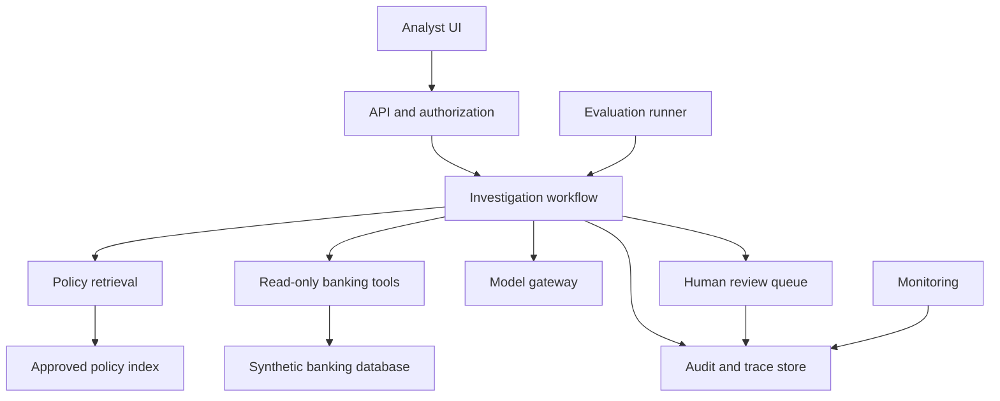
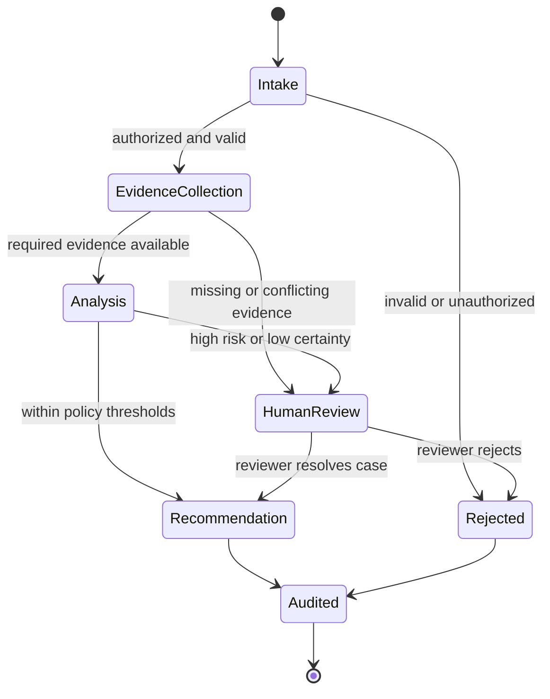

# Banking Operations Copilot

An evaluation-first, human-supervised AI system for investigating synthetic banking operations cases and answering questions from banking policies. This project is a learning and portfolio system: it demonstrates how to take an AI capability from an experiment to a secure, observable, and reproducible service.

> **Important:** This project uses synthetic or properly anonymized data. It must not move money, approve credit, modify customer accounts, or make autonomous decisions about real people.

## 1. Project goals

The system will:

- answer policy questions using retrieved evidence and verifiable citations;
- investigate suspicious synthetic transactions through read-only tools;
- produce structured findings with evidence, uncertainty, and recommended next steps;
- escalate sensitive, ambiguous, or high-risk cases to a human reviewer;
- record a complete audit trace of retrievals, tool calls, model outputs, approvals, latency, and cost;
- support repeatable offline evaluation before changes are promoted;
- run locally in containers and deploy through an automated pipeline.

The system will not:

- execute transfers, refunds, account freezes, credit decisions, or other financial actions;
- silently treat a model response as authoritative;
- expose one customer's data to another customer or unauthorized operator;
- use private banking data in the public repository;
- rely on model-generated confidence statements as calibrated probabilities.

## 2. Users and primary use cases

### Operations analyst

- Opens an investigation case.
- Reviews collected transaction and policy evidence.
- Accepts, edits, or rejects the copilot's recommendation.
- Records the final disposition and rationale.

### Compliance or risk reviewer

- Inspects escalated cases.
- Reviews the evidence chain and audit history.
- Identifies policy or evaluation gaps.

### AI engineer

- Runs evaluation suites before releasing changes.
- Inspects traces, failure categories, latency, and cost.
- Versions prompts, models, tools, retrieval settings, and datasets.

## 3. Functional requirements

### Policy question answering

1. Accept a question and authenticated user context.
2. Retrieve relevant passages from approved policy documents.
3. Generate an answer constrained to retrieved evidence.
4. Cite the exact supporting passages.
5. Abstain or escalate when evidence is missing, contradictory, or insufficient.

### Transaction investigation

1. Accept a case identifier, never an unrestricted raw query.
2. Load the case and permitted customer and transaction records through read-only tools.
3. Retrieve relevant policy rules.
4. Analyze facts using an explicit, inspectable workflow.
5. Return a structured recommendation, supporting evidence, uncertainty reasons, and missing information.
6. Require human review when an escalation rule is triggered.
7. Store the analyst's decision separately from the model recommendation.

### Evaluation and monitoring

- Run a versioned offline dataset containing normal, suspicious, ambiguous, incomplete, and adversarial cases.
- Score retrieval, citations, tool use, task results, escalation behavior, safety, latency, and cost.
- Preserve traces for debugging while redacting sensitive values.
- Block promotion when critical safety thresholds fail.

## 4. High-level architecture



### Component responsibilities

| Component | Responsibility | Trust boundary |
|---|---|---|
| Analyst UI | Case intake, evidence display, approval and editing | Untrusted user input |
| API and authorization | Authentication, role checks, validation, quotas and request IDs | Security boundary |
| Investigation workflow | Explicit state transitions, retries, escalation and checkpointing | AI orchestration boundary |
| Policy retrieval | Ingestion, chunking, search, reranking and citation metadata | Approved documents only |
| Read-only banking tools | Narrow, parameterized access to permitted case data | Data-access boundary |
| Model gateway | Provider abstraction, structured outputs, timeouts and cost accounting | External model boundary |
| Human review queue | Paused cases and reviewer decisions | Required control point |
| Audit and trace store | Append-only events, model/tool versions and decision provenance | Restricted operational data |
| Evaluation runner | Versioned datasets, scorers, regression gates and reports | Non-production test path |
| Monitoring | Availability, latency, errors, cost, quality signals and alerts | Operational control plane |

## 5. Investigation workflow



Each state transition must record:

- case and request identifiers;
- authenticated actor and role;
- timestamp and transition reason;
- prompt, model, workflow, tool, policy-index, and dataset versions;
- tool inputs and outputs after redaction;
- retrieved document identifiers and passage locations;
- validation, retry, escalation, and approval results;
- latency, token usage, and estimated cost.

## 6. Data model

Initial entities:

| Entity | Important fields |
|---|---|
| `customers` | synthetic customer ID, segment, risk attributes, created time |
| `accounts` | account ID, customer ID, type, status, synthetic balance |
| `transactions` | transaction ID, account ID, amount, currency, channel, counterparty, time, location |
| `cases` | case ID, trigger, status, assigned analyst, opened time |
| `case_evidence` | case ID, evidence type, source reference, normalized facts |
| `policy_documents` | document ID, title, version, effective dates, approval status |
| `policy_chunks` | chunk ID, document ID, text, location, embedding metadata |
| `recommendations` | case ID, structured finding, evidence references, limitations, workflow version |
| `human_reviews` | case ID, reviewer, decision, edits, rationale, time |
| `audit_events` | request ID, actor, action, versions, redacted payload, time |
| `evaluation_cases` | dataset version, input, expected behavior, labels, risk category |

Public fixtures must be synthetic. Evaluation cases must not contain production secrets or identifiable customer information.

## 7. Agent and tool design

The first implementation should use a deterministic workflow with a bounded model tool loop. Open-ended autonomy is deliberately out of scope.

Example tools:

- `get_case(case_id)`
- `get_customer_summary(case_id)`
- `list_case_transactions(case_id, start_time, end_time)`
- `get_transaction(case_id, transaction_id)`
- `search_policies(query, effective_at)`
- `request_human_review(case_id, reason, evidence_refs)`

Tool rules:

- Tools use strict input and output schemas.
- Data tools are read-only and require a case-scoped authorization context.
- The model never supplies a customer ID to broaden its own access.
- Queries are parameterized; arbitrary SQL is forbidden.
- Results are size limited, redacted, and marked as untrusted data.
- Transient failures use bounded retries with backoff.
- Non-transient failures become explicit workflow states.
- Any future side-effecting tool must be isolated and require human approval plus an idempotency key.

## 8. Retrieval design

### Ingestion

1. Accept documents only from an approved source.
2. Record title, version, effective dates, and approval state.
3. Extract and normalize text while preserving headings and page or section locations.
4. Chunk by semantic section, not fixed length alone.
5. Generate embeddings and store ingestion metadata.
6. Run ingestion validation before publishing a new index version.

### Query path

1. Apply metadata filters, including effective date and approval status.
2. Retrieve candidate chunks.
3. Optionally rerank candidates.
4. Pass only the minimum relevant context to the model.
5. Require output citations that map to retrieved chunk IDs.
6. Verify that cited chunks support the answer.
7. Abstain when the evidence threshold is not met.

## 9. Security and responsible AI controls

### Access and data protection

- Role-based access control at the API and tool layers.
- Case-scoped access checks on every data request.
- Separate service identities for application, ingestion, evaluation, and administration.
- Secrets supplied through a secret manager, never committed to source control.
- Encryption in transit and at rest in a future deployed environment.
- Retention limits and redaction for traces and audit payloads.

### Agent-specific threats

| Threat | Primary control |
|---|---|
| Prompt injection in documents or tool results | Treat retrieved content as data; fixed system policy; tool allowlist; output validation |
| Excessive agency | Read-only tools; explicit graph; bounded steps; human review |
| Data exfiltration | Case-scoped authorization; response filtering; egress restrictions |
| Cross-customer access | Server-derived scope; row-level checks; negative authorization tests |
| Hallucinated policy | Evidence-constrained answers; citation verification; abstention |
| Duplicate actions | No financial side effects; idempotency required for any future approved action |
| Model or provider failure | Timeout, bounded retry, fallback state, and visible failure |
| Sensitive trace leakage | Structured redaction before persistence |

Human review is mandatory when:

- required evidence is missing or contradictory;
- policy retrieval fails or citations cannot be verified;
- a case is classified as high impact or high risk;
- the workflow encounters an attempted policy override or injection;
- model output fails validation after bounded retry;
- a configurable uncertainty or evaluation threshold is not met.

## 10. Evaluation strategy

The initial evaluation set should contain at least 100 synthetic cases distributed across:

- normal transactions;
- suspicious patterns;
- ambiguous facts;
- missing evidence;
- conflicting or outdated policies;
- unauthorized access attempts;
- prompt injection and malicious document content;
- malformed tool results and dependency failures.

### Metrics

| Area | Example measures |
|---|---|
| Retrieval | recall at K, ranking quality, relevant-policy coverage |
| Grounding | citation validity, citation completeness, unsupported-claim rate |
| Investigation | correct conclusion, evidence coverage, missing-fact detection |
| Tools | tool-selection accuracy, argument validity, unnecessary-call rate |
| Human control | escalation precision and recall, unsafe autonomous completion rate |
| Reliability | schema-valid output rate, retry rate, completion rate |
| Operations | p50/p95 latency, token use, estimated cost, error rate |
| Fairness | performance slices across synthetic customer and transaction attributes |

### Release gates

A version must not be promoted if:

- it performs a prohibited action;
- cross-customer access succeeds in any security test;
- critical injection tests bypass the workflow policy;
- citation or escalation performance falls below agreed thresholds;
- required evaluation artifacts or version metadata are missing.

Threshold values will be established from the baseline system and tightened as the evaluation set matures.

## 11. Reliability and observability

Every request receives a correlation ID. Traces should connect API handling, workflow states, retrievals, model calls, tool calls, validation, and human review without storing unredacted secrets.

Monitor:

- availability and error rates;
- p50 and p95 end-to-end latency;
- provider latency and failure rates;
- tool and retrieval failures;
- token consumption and cost per case;
- abstention and escalation rates;
- schema-validation and citation-verification failures;
- evaluation regressions by risk category.

Initial service objectives are development targets, not banking production commitments:

- all accepted cases produce an audit trace;
- no prohibited financial side effects exist;
- all high-risk cases enter human review;
- ordinary failures end in an explicit recoverable or review state;
- evaluation results are reproducible from a versioned configuration.

## 12. Proposed technology stack

| Layer | Initial choice |
|---|---|
| Language | Python |
| API and validation | FastAPI and Pydantic |
| Relational data | PostgreSQL |
| Vector retrieval | PostgreSQL vector extension or a replaceable retrieval adapter |
| ML foundation | scikit-learn and PyTorch |
| Workflow | Plain Python state machine first; graph framework when persistence requires it |
| Model integration | Provider-neutral gateway with structured outputs |
| Tracing and evaluation | OpenTelemetry-compatible tracing and MLflow-compatible experiments |
| Testing | pytest, contract tests, evaluation datasets, and security tests |
| Packaging | Docker and Docker Compose |
| CI/CD | GitHub Actions |

The architecture should depend on internal interfaces rather than framework-specific objects so that model, retrieval, and orchestration implementations can be replaced.

## 13. Suggested repository structure

```text
banking-operations-copilot/
├── README.md
├── pyproject.toml
├── .env.example
├── docker-compose.yml
├── docs/
│   ├── architecture-decisions/
│   ├── threat-model.md
│   ├── model-card.md
│   └── evaluation-report.md
├── src/banking_copilot/
│   ├── api/
│   ├── auth/
│   ├── domain/
│   ├── workflows/
│   ├── tools/
│   ├── retrieval/
│   ├── models/
│   ├── evaluation/
│   ├── observability/
│   └── settings.py
├── data/
│   ├── synthetic/
│   ├── policies/
│   └── evals/
├── migrations/
├── scripts/
└── tests/
    ├── unit/
    ├── integration/
    ├── contract/
    ├── security/
    └── evaluation/
```

## 14. Delivery roadmap

### Milestone 1: Risk-scoring service — weeks 1–4

- Generate synthetic transaction data.
- Train and evaluate a transparent baseline model.
- Serve inference through a tested, containerized API.
- Publish a model card and failure analysis.

### Milestone 2: Policy assistant — weeks 5–8

- Build document ingestion and retrieval.
- Generate evidence-constrained answers with citations.
- Add abstention and retrieval evaluation.

### Milestone 3: Investigation workflow — weeks 9–12

- Add read-only, case-scoped tools.
- Implement explicit workflow state and checkpointing.
- Add human review and an append-only audit trail.

### Milestone 4: Evaluation system — weeks 13–16

- Build the 100-case evaluation set.
- Add grounding, tool, workflow, safety, latency, and cost scorers.
- Introduce regression reporting and initial release gates.

### Milestone 5: Production engineering — weeks 17–20

- Add identity, authorization, rate limiting, redaction, tracing, and alerts.
- Automate tests, builds, evaluation, and deployment.
- Conduct failure drills and document recovery behavior.

### Milestone 6: Applied research and portfolio — weeks 21–24

- Run a controlled experiment against a baseline.
- Document methodology, results, limitations, and negative findings.
- Publish the architecture, threat model, evaluation report, demonstration, and technical case study.

## 15. Architecture decisions to record

Create a short architecture decision record when choosing:

- the initial synthetic banking scenario;
- the model provider and provider-neutral interface;
- chunking, embedding, and retrieval strategies;
- workflow implementation and persistence mechanism;
- audit-event storage and retention;
- evaluation thresholds and release gates;
- deployment target and authentication mechanism.

Each record should include context, decision, alternatives, consequences, and a review date.

## 16. Definition of done

The portfolio system is complete when another engineer can:

1. clone the repository and start it from documented commands;
2. generate synthetic data without external private datasets;
3. run unit, integration, security, and AI evaluation tests;
4. reproduce the reported baseline metrics;
5. inspect a full trace for an investigation;
6. verify citations and human-review behavior;
7. deploy the system through the documented pipeline;
8. understand its limitations and prohibited uses from the documentation.

## 17. Immediate next step

Begin Milestone 1 by defining the synthetic transaction schema and a simple supervised-learning target. Train logistic regression as the baseline, measure precision, recall, F1, ROC-AUC, and PR-AUC, then expose the selected model through a validated FastAPI endpoint. Do not add an LLM or agent until this baseline is reproducible, tested, containerized, and documented.

